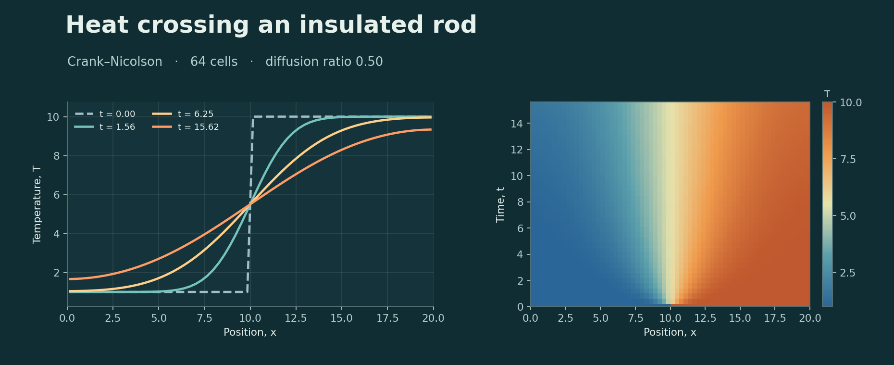

# Thermal Diffusion Lab

[Interactive simulation](https://pialbertshi.github.io/Thermal-Diffusion-Lab/) · [中文说明](README.zh-CN.md)

Thermal Diffusion Lab models heat conduction along a rod with insulated ends. A C++17 solver advances the same temperature field with Forward Euler, Backward Euler or Crank–Nicolson. The web interface displays the computed profiles at matched times, alongside the mean temperature, the temperature range and a fixed-position probe.

[](https://pialbertshi.github.io/Thermal-Diffusion-Lab/)

## Simulation cases

| Initial temperature field | Physical behaviour | Reported quantity |
|---|---|---|
| Hot–cold interface | The left and right halves start at 1 and 10. Diffusion smooths the jump while the spatial mean remains 5.5. | Temperature profile and maximum–minimum temperature difference |
| Single cosine mode | The profile retains its shape as its amplitude decays exponentially. | Maximum absolute error against the analytical solution |
| Local heat pulse | A Gaussian pulse spreads from the midpoint toward both insulated ends. | Space–time field and temperature history at a selected cell |

The web dataset covers 24 combinations of initial field, time integrator and diffusion ratio. Each run contains 41 snapshots on the same time grid. Both the 64-cell profile at a selected time and the 41-sample history at a selected position are available as CSV.

## Numerical method

The model has constant diffusivity $\alpha$ and zero heat flux at each boundary.

$$
\frac{\partial T}{\partial t}=\alpha\frac{\partial^2 T}{\partial x^2},
\qquad
\frac{\partial T}{\partial x}(0,t)=\frac{\partial T}{\partial x}(L,t)=0.
$$

The default rod has length 20 and diffusivity 1 in model units. A cell-centred finite-volume discretization uses equal and opposite fluxes across each internal face. These contributions cancel when summed over the grid, conserving the spatial mean.

| Time integrator | Temporal order | Update |
|---|---:|---|
| Forward Euler | 1 | Explicit update with diffusion ratio $r=\alpha\Delta t/\Delta x^2 \le 0.5$ |
| Backward Euler | 1 | Implicit tridiagonal solve using end-of-step fluxes |
| Crank–Nicolson | 2 | Implicit tridiagonal solve using the average of the initial and final fluxes within the time step |

Both implicit schemes factor the constant tridiagonal matrix once. Each step takes $O(N)$ work and storage for $N$ cells. Crank–Nicolson is linearly stable for large steps, although sharp initial gradients can produce high-frequency oscillations.

## Verification

I use a single cosine mode to check the solution at every cell centre. Its closed-form temperature is

$$
T(x,t)=5.5+4.5\cos(\pi x/L)\exp(-\alpha\pi^2 t/L^2).
$$

The refinement test uses $L=1$, $\alpha=1$, $r=0.25$ and final time $t=0.03125$ on both grids.

| Scheme | Maximum absolute error on 64 cells | Error ratio, 32 cells to 64 |
|---|---:|---:|
| Forward Euler | 0.00010235 | 3.998 |
| Backward Euler | 0.00051144 | 3.991 |
| Crank–Nicolson | 0.00020462 | 3.994 |

Halving the cell width at fixed $r$ also quarters the time step. The approximately fourfold reduction in error therefore measures combined spatial and temporal refinement. Seven native test groups cover conservation, symmetry, the analytical solution, refinement, a discrete eigenmode, stability and input handling. Continuous integration reruns the solver and checks all 62,976 temperatures published in the web dataset. [Solver implementation](src/solver.cpp) · [Verification cases](tests/solver_checks.cpp)

## Build and run

The project requires a C++17 compiler and CMake 3.20 or newer.

```sh
cmake -S . -B build -DCMAKE_BUILD_TYPE=Release
cmake --build build --config Release
ctest --test-dir build -C Release --output-on-failure
./build/diffusion_cli --method crank-nicolson --profile step --ratio 0.5 --cells 64 --steps 128 --output profile.csv
./build/diffusion_cli --method crank-nicolson --steps 128 --probe 4 --output trace.csv
```

With Visual Studio on Windows, the executable is `build\Release\diffusion_cli.exe`. The first command-line example exports the final temperature profile. The second records the cell nearest $x=4$ after each step, including the initial state. Both CSV files include the cell-centre coordinate, physical time and temperature.

To regenerate and serve the web dataset locally, run the following commands from the repository root.

```sh
./build/diffusion_cli --gallery docs/data/profiles.json
python -m http.server 8000 --directory docs
```

The local viewer is available at `http://localhost:8000`. The project figure is generated from the same dataset with Matplotlib. [Figure script](tools/render_preview.py)
