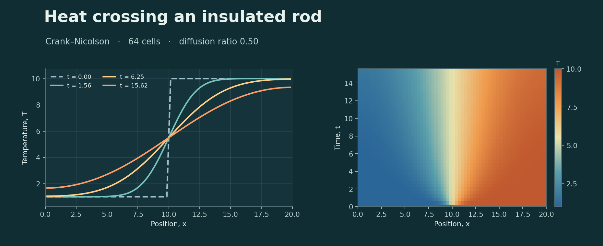

# 一维热扩散实验室

[在线数值演示](https://pialbertshi.github.io/Thermal-Diffusion-Lab/) · [English](README.md)

本项目模拟绝热细杆中的一维非稳态导热。C++17 求解器在相同网格上实现前向欧拉、后向欧拉和 Crank–Nicolson 三种时间离散格式。交互界面在同一物理时刻呈现各格式的温度分布，并提供时空温度图、定点温度记录及 CSV 导出。

[](https://pialbertshi.github.io/Thermal-Diffusion-Lab/)

## 计算工况

| 初始温度场 | 温度演化 | 输出指标 |
|---|---|---|
| 冷热阶跃 | 左、右半杆初温分别为 1 和 10。界面温差逐渐减小，全杆平均温度保持 5.5。 | 温度剖面、最高与最低温度之差 |
| 单一余弦模态 | 温度场保持余弦形状，振幅按指数规律衰减。 | 各单元中心数值解与解析解的最大绝对误差 |
| 局部高斯热脉冲 | 位于杆中部的热脉冲向两端对称扩散，峰值随时间降低。 | 时空温度图、指定位置的温度历程 |

网页收录 24 组参数组合，每组在 41 个相同的物理时刻采样。空间剖面导出给定时刻的 64 个单元温度，定点探针导出所选单元的 41 个采样值。

## 数值方法

模型采用常热扩散率 $\alpha$，细杆两端为零热通量边界。默认算例取杆长 $L=20$、热扩散率 $\alpha=1$，各变量使用模型单位。空间离散采用等距单元中心有限体积法。每个内部单元面的通量对相邻两个单元的贡献大小相等、方向相反，因此离散系统守恒总热量。

显式欧拉格式要求扩散比 $r=\alpha\Delta t/\Delta x^2\leq 0.5$。后向欧拉与 Crank–Nicolson 在固定网格和时间步长下复用三对角矩阵的分解，每步计算量与单元数成正比。Crank–Nicolson 在时间上具有二阶精度。面对阶跃初值，过大的时间步长仍可能引入高频振荡。

## 解析验证与网格加密

我选用具有闭式解的单一余弦模态，在每个单元中心核对温度。参考解为

$$
T(x,t)=5.5+4.5\cos(\pi x/L)\exp(-\alpha\pi^2t/L^2).
$$

取 $L=1$、$\alpha=1$、$r=0.25$，两套网格均推进至 $t=0.03125$。

| 时间格式 | 64 单元最大绝对误差 | 32 单元与 64 单元的误差之比 |
|---|---:|---:|
| 前向欧拉 | 0.00010235 | 3.998 |
| 后向欧拉 | 0.00051144 | 3.991 |
| Crank–Nicolson | 0.00020462 | 3.994 |

固定扩散比时，空间步长减半，时间步长也缩小为原来的四分之一。表中误差比反映的是空间与时间同步加密的结果。项目另设 7 组 C++ 测试，并在持续集成中重新计算、逐项核对网页使用的 62,976 个温度值。[求解器](src/solver.cpp) · [验证算例](tests/solver_checks.cpp)

## 构建与输出

项目需要 C++17 编译器和 CMake 3.20 或更高版本。从仓库根目录执行以下命令可构建求解器并运行测试。

```sh
cmake -S . -B build -DCMAKE_BUILD_TYPE=Release
cmake --build build --config Release
ctest --test-dir build -C Release --output-on-failure
./build/diffusion_cli --method crank-nicolson --profile step --ratio 0.5 --cells 64 --steps 128 --output profile.csv
./build/diffusion_cli --method crank-nicolson --steps 128 --probe 4 --output trace.csv
```

使用 Visual Studio 构建时，Windows 可执行文件位于 `build\Release\diffusion_cli.exe`。`profile.csv` 保存末时刻的空间剖面，`trace.csv` 记录距 $x=4$ 最近的单元从初始状态至末步的温度。两种文件均提供位置、物理时间和温度三列。
